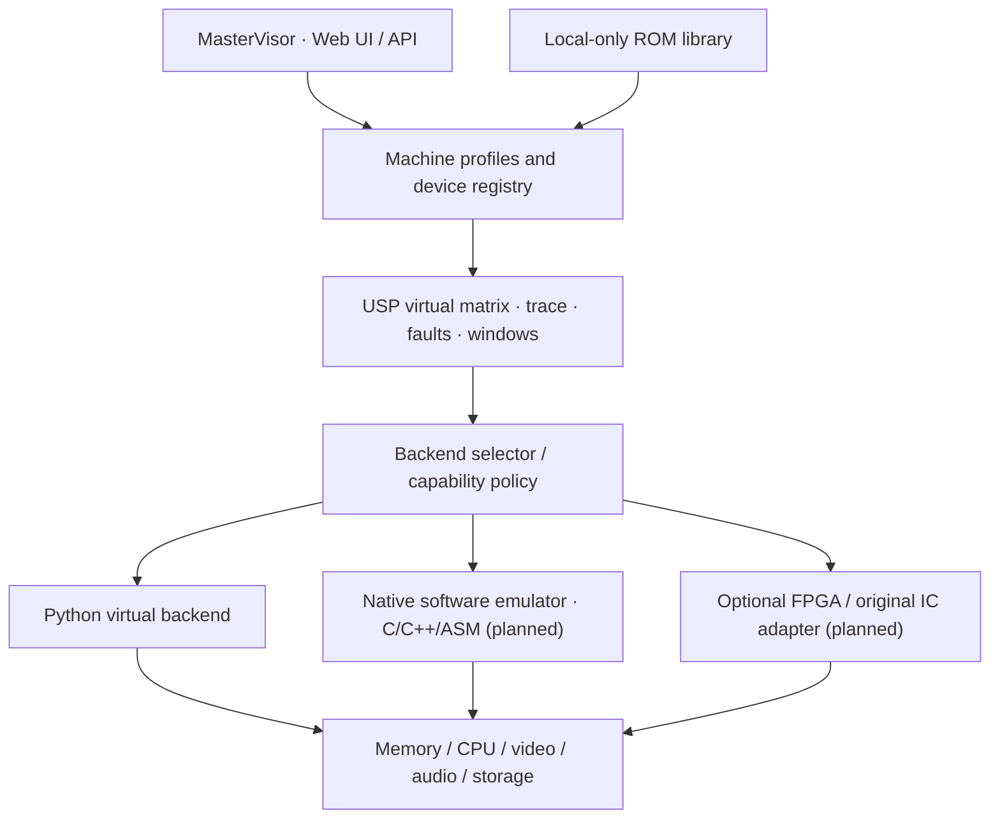

<div align="center">

# USM-Ultra

### Universal Silicon Matrix · Virtual Lab · MasterVisor

**Software-first historical computing, heterogeneous emulation and optional real-chip integration**


[Quickstart](#quickstart) · [Architecture](docs/ARCHITECTURE.md) · [Virtual-first contract](docs/VIRTUAL_FIRST.md) · [Research V7](docs/STUDIE_V7.md) · [Roadmap](ROADMAP.md) · [Contributing](CONTRIBUTING.md)

</div>

---

## Purpose

USM-Ultra is a modular virtual-first platform for historical computers, custom ICs and recovery workflows. **It must ultimately work completely without physical hardware.** Once compatible real chips or FPGA adapters are available, the operator may select them for individual logical components. Hardware is never a mandatory dependency.

> **Current status:** Experimental Python functional prototype including a partial USM-6502 SBC, monitor, BIN/PRG loader, simplified peripherals and a host-side BASIC fallback. No complete historical computer, native 6502 BASIC, Musashi backend or physical hardware integration yet.

## System overview



| Component | Present | Planned |
| --- | --- | --- |
| USP-style functional matrix | Yes | Typed faults and timing models |
| RAM/ROM windows and generation | Yes | Staged atomic register map |
| Task scheduler and leases | Yes | Strict fairness and deduplication |
| 68000 machine-code execution | Tiny smoke-test interpreter | Musashi C backend |
| MasterVisor | Local FastAPI dashboard | Profile editor and hybrid management |
| ROM inventory | Local SHA-256 | Format-aware private library |
| Software-only full machines | Not yet | Atari ST, Amiga, Z80 profiles |
| Real-chip / FPGA coupling | Not yet | Optional hot-select with safe restart/fallback |

## Quickstart

Python 3.11+ required:

```bash
git clone https://github.com/Thomas-Heisig/USM-Ultra.git
cd USM-Ultra
python -m venv .venv
python -m pip install -e ".[6502,web,test]"
python -m pytest -q
python -m usm.cli status
python -m usm.cli web
```

MasterVisor: http://127.0.0.1:8000 (localhost development only). API schema: http://127.0.0.1:8000/openapi.json.

## Development rules

- Virtual backend is the default; **no hardware requirement**.
- Hardware must be discovered and capability-checked before use.
- If switching cannot preserve state safely, use a controlled reset, not an assumed seamless migration.
- Python models functional semantics, not measured T0 bus timing.
- ROMs, disk images, recovery files, manifests and secrets stay local and outside Git.
- Third-party emulator code must be pinned and license-reviewed before integration.

## Documentation and project standards

- [Documentation index](docs/README.md)
- [V7 scientific study chapter guide](docs/STUDIE_V7.md) (the full illustrated DOCX has not yet been uploaded to GitHub)
- [Virtual-first / hybrid specification](docs/VIRTUAL_FIRST.md)
- [V0.2 code review](docs/CODE_REVIEW_V02.md)
- [Musashi integration plan](docs/MUSASHI_INTEGRATION.md)
- [Roadmap](ROADMAP.md) · [Changelog](CHANGELOG.md)
- [Security](SECURITY.md) · [Contributing](CONTRIBUTING.md) · [Support](SUPPORT.md)
- [License](LICENSE) · [Third-party notices](NOTICE.md)

## Credits and licensing

Original project: Thomas Heisig. Copyright © 2026 Thomas Heisig. All rights reserved. This private repository does not grant a public open-source license. Musashi, Hatari, WinUAE, MAME and Z80 projects are prospective integrations or references; none is automatically bundled. Their upstream licenses and notices must be respected.

- [Current implementation status](STATUS.md) · [Chip inventory](docs/CHIP_CATALOG.md) · [Operating modes and timing](docs/MODES_AND_TIMING.md)

## MasterVisor settings

The dashboard now exposes local settings, capability flags and a documentation directory. See [settings guide](docs/SETTINGS.md). Hybrid and physical modes remain disabled until real backends exist.

## USM-6502: aktueller Funktionsumfang

Das erste Maschinenprofil ist ein **eigener virtueller 6502-Einplatinencomputer** mit py65, 32 KiB RAM, 8 KiB synthetischem ROM, UART RX/TX, Timer und GPIO. Die Geräte sind **USM-spezifische Modelle**, keine vollständigen historischen ACIA/VIA-Chips. Der Monitor unterstützt BIN/PRG-Laden in RAM, Reset, begrenztes Ausführen, Einzelschritt, Breakpoints, RAM-Inspektion und -Änderung. ROM-, D64-, DSK- und WOZ-Boot sind noch nicht implementiert.

Ein selbst geschriebenes 6502-Startprogramm sendet `USM 6502 READY` an die virtuelle UART. Im MasterVisor steht zusätzlich eine einfache interaktive BASIC-Konsole mit PRINT, LET, IF/THEN, GOTO, RUN, LIST und NEW bereit. **Diese BASIC-Konsole läuft auf Python, nicht auf der emulierten 6502-CPU.** Tiny BASIC/EhBASIC als nativer 6502-Binärcode bleibt offen.

Lokale Maschinen-Arbeitsbereiche enthalten Software, ROM-Verzeichnisse und CPU/RAM/Peripherie-Snapshots. Die Snapshot-Kompatibilität ist derzeit an das py65-Backend und das ROM gebunden; echte Hardware kann noch nicht wiederhergestellt werden.

### Starten

```bash
python -m pip install -e ".[6502,web,test]"
python -m pytest -q
python -m usm.cli web
```

Danach MasterVisor unter http://127.0.0.1:8000 öffnen. Die Installation von py65 ist **erforderlich**, um den 6502 auszuführen. Der Server darf ohne zusätzliche Absicherung nicht ins öffentliche Netz gestellt werden.

### Aktueller Projektstatus

| Bereich | Stand |
| --- | --- |
| USP-Matrix, RAM/ROM, WindowManager, Task Queue | Funktionaler Prototyp |
| 6502 CPU und eigenes SBC-Profil | Teilweise ausführbar über py65 |
| Monitor, BIN/PRG-Loader, Breakpoints | Implementiert, E2E noch nicht bestätigt |
| UART, Timer, GPIO | Vereinfachte virtuelle Peripherie |
| Startprogramm in echtem 6502-Code | Implementiert, E2E noch nicht bestätigt |
| BASIC-Konsole | Python-Host-Fallback, **kein natives 6502-BASIC** |
| Snapshot/Arbeitsbereich | Lokale Persistenz, weitere Integritätsprüfung offen |
| Apple I/II, C64, Atari, NES | Referenzprofile, **nicht emuliert** |
| Musashi m68k, Z80-Vollkern | Nicht integriert |
| FPGA/echte Chips | Nicht angeschlossen, optional für die Zukunft |
| Vollständige V7-DOCX im Repository | Noch nicht vorhanden |

## Dokumentation

- [Dokumentationsindex](docs/README.md) · [Status](STATUS.md) · [Offene Aufgaben](TODO.md) · [Roadmap](ROADMAP.md)
- [6502-Monitor und Image-Loader](docs/MONITOR_6502.md) · [6502-Peripherie](docs/PERIPHERALS_6502.md)
- [BASIC: Implementierung und native Portierung](docs/BASIC_6502.md) · [Maschinen-Arbeitsbereiche](docs/MACHINE_WORKSPACES.md)
- [MOS 6502: Technik, Quellen, historische Systeme](docs/MOS_6502_REFERENCE.md)
- [Virtual-First-Architektur](docs/VIRTUAL_FIRST.md) · [MasterVisor](docs/MASTER_VISOR.md)
- [V7-Studienübersicht](docs/STUDIE_V7.md) (vollständige illustrierte DOCX noch nicht eingecheckt)
- [Entwicklungsrichtlinien](CONTRIBUTING.md) · [Sicherheit](SECURITY.md) · [Lizenz](LICENSE) · [Drittanbieter](NOTICE.md)

## Rechte und Grenzen

Das Repository ist privat und die Projektlizenz proprietär. Fremde Open-Source-Projekte werden als Referenzen katalogisiert, aber ohne gesonderte Lizenzprüfung nicht automatisch eingebunden. Original-ROMs und Diskettenabbilder werden nicht in Git veröffentlicht. Der Betrieb soll dauerhaft auch ohne physische Hardware möglich bleiben.

## Öffentlicher MasterVisor (GitHub Pages)

Die [statische Online-Demo](https://thomas-heisig.github.io/USM-Ultra/) wird aus `docs/index.html` mit [GitHub Actions](.github/workflows/pages.yml) veröffentlicht, **sobald GitHub Pages in den Repository-Einstellungen auf GitHub Actions gestellt und ein Deployment erfolgreich abgeschlossen wurde**. Sie enthält eine browserseitige BASIC-Demo und den Modulstatus, jedoch noch keine serverseitige 6502-CPU-Emulation. [Aktivierung und Sicherheitsgrenzen](docs/ONLINE_DEPLOYMENT.md).
