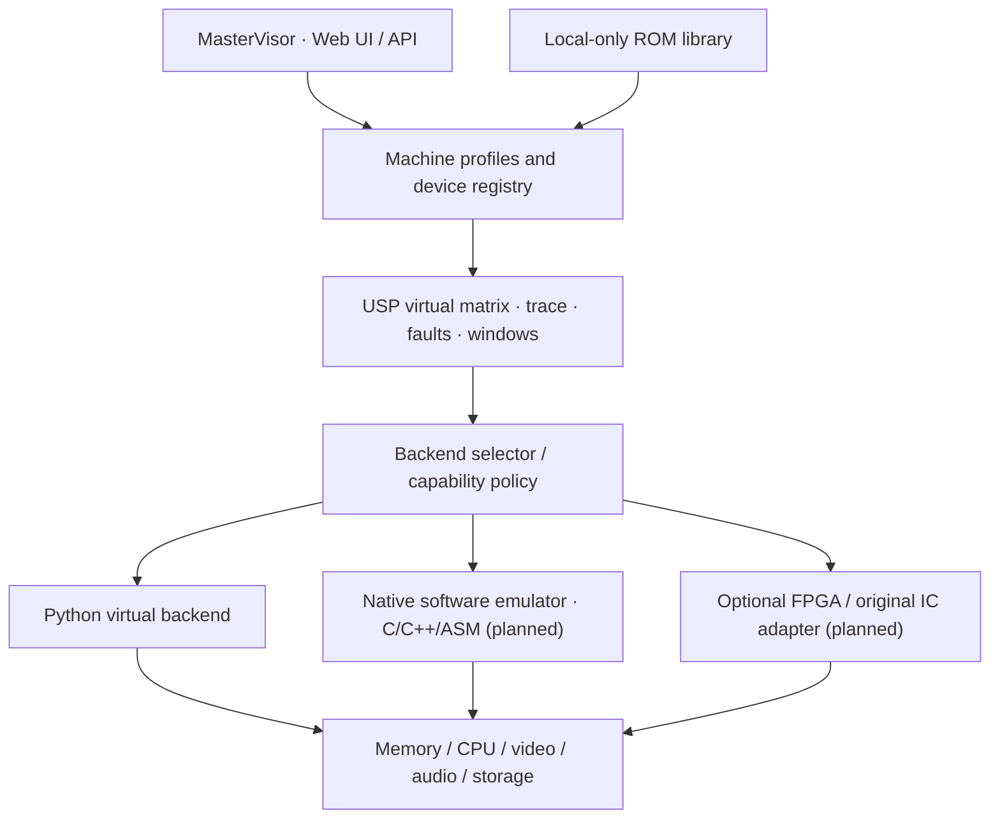

<div align="center">

# USM-Ultra

### Universal Silicon Matrix · Virtual Lab · MasterVisor

**Software-first historical computing, heterogeneous emulation and optional real-chip integration**


[Quickstart](#quickstart) · [Architecture](docs/ARCHITECTURE.md) · [Virtual-first contract](docs/VIRTUAL_FIRST.md) · [Research V7](docs/STUDIE_V7.md) · [Roadmap](ROADMAP.md) · [Contributing](CONTRIBUTING.md)

</div>

---

## Purpose

USM-Ultra is a modular virtual-first platform for historical computers, custom ICs and recovery workflows. **It must ultimately work completely without physical hardware.** Once compatible real chips or FPGA adapters are available, the operator may select them for individual logical components. Hardware is never a mandatory dependency.

> **Current status:** Experimental Python functional prototype. No complete Atari ST, Amiga or Z80 machine boot; no real Musashi binding or hardware-in-the-loop yet. The current mini-68000 is a limited machine-code smoke-test interpreter, not a complete emulator.

## System overview



| Component | Present | Planned |
| --- | --- | --- |
| USP-style functional matrix | Yes | Typed faults and timing models |
| RAM/ROM windows and generation | Yes | Staged atomic register map |
| Task scheduler and leases | Yes | Strict fairness and deduplication |
| 68000 machine-code execution | Tiny smoke-test interpreter | Musashi C backend |
| MasterVisor | Local FastAPI dashboard | Profile editor and hybrid management |
| ROM inventory | Local SHA-256 | Format-aware private library |
| Software-only full machines | Not yet | Atari ST, Amiga, Z80 profiles |
| Real-chip / FPGA coupling | Not yet | Optional hot-select with safe restart/fallback |

## Quickstart

Python 3.11+ required:

```bash
git clone https://github.com/Thomas-Heisig/USM-Ultra.git
cd USM-Ultra
python -m venv .venv
python -m pip install -e ".[web,test]"
python -m pytest -q
python -m usm.cli status
python -m usm.cli web
```

MasterVisor: http://127.0.0.1:8000 (localhost development only). API schema: http://127.0.0.1:8000/openapi.json.

## Development rules

- Virtual backend is the default; **no hardware requirement**.
- Hardware must be discovered and capability-checked before use.
- If switching cannot preserve state safely, use a controlled reset, not an assumed seamless migration.
- Python models functional semantics, not measured T0 bus timing.
- ROMs, disk images, recovery files, manifests and secrets stay local and outside Git.
- Third-party emulator code must be pinned and license-reviewed before integration.

## Documentation and project standards

- [Documentation index](docs/README.md)
- [V7 scientific study chapter guide](docs/STUDIE_V7.md) (the full illustrated DOCX has not yet been uploaded to GitHub)
- [Virtual-first / hybrid specification](docs/VIRTUAL_FIRST.md)
- [V0.2 code review](docs/CODE_REVIEW_V02.md)
- [Musashi integration plan](docs/MUSASHI_INTEGRATION.md)
- [Roadmap](ROADMAP.md) · [Changelog](CHANGELOG.md)
- [Security](SECURITY.md) · [Contributing](CONTRIBUTING.md) · [Support](SUPPORT.md)
- [License](LICENSE) · [Third-party notices](NOTICE.md)

## Credits and licensing

Original project: Thomas Heisig. Copyright © 2026 Thomas Heisig. All rights reserved. This private repository does not grant a public open-source license. Musashi, Hatari, WinUAE, MAME and Z80 projects are prospective integrations or references; none is automatically bundled. Their upstream licenses and notices must be respected.

- [Current implementation status](STATUS.md) · [Chip inventory](docs/CHIP_CATALOG.md) · [Operating modes and timing](docs/MODES_AND_TIMING.md)

## MasterVisor settings

The dashboard now exposes local settings, capability flags and a documentation directory. See [settings guide](docs/SETTINGS.md). Hybrid and physical modes remain disabled until real backends exist.

## First executable target: USM-6502

Install `pip install -e ".[6502,web,test]"`, then run `python -m usm.cli 6502` or use **6502-ROM starten** in MasterVisor. This is a minimal 6502 SBC ROM/UART boot demo, **not** a complete interactive monitor or a C64/Apple II emulator. [Machine specification](docs/USM_6502.md).

## MasterVisor frontend

The responsive MasterVisor is the primary browser interface, with dedicated pages for dashboard, machines, chip modules, USP matrix, memory, task queue, trace, hardware, recovery, settings and documentation. See [MasterVisor manual](docs/MASTER_VISOR.md). The development server is localhost-only; hardware and recovery operations remain disabled until implemented.
